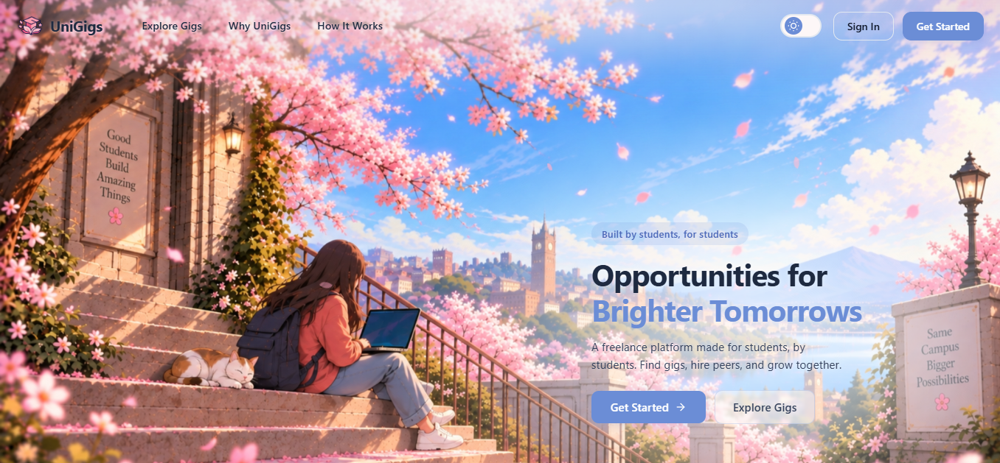
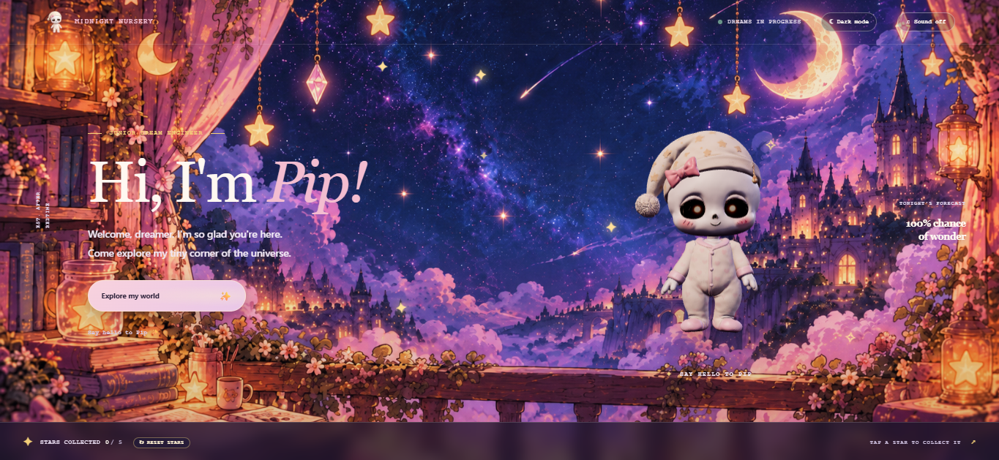
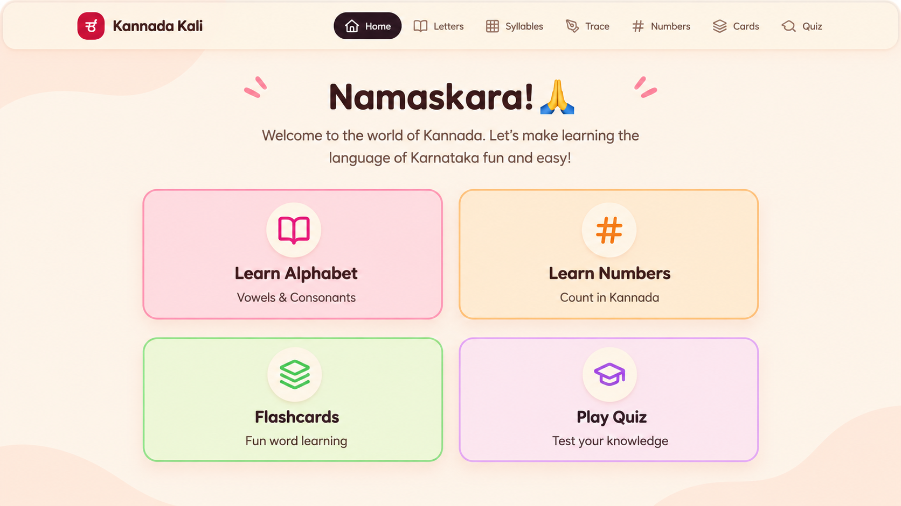
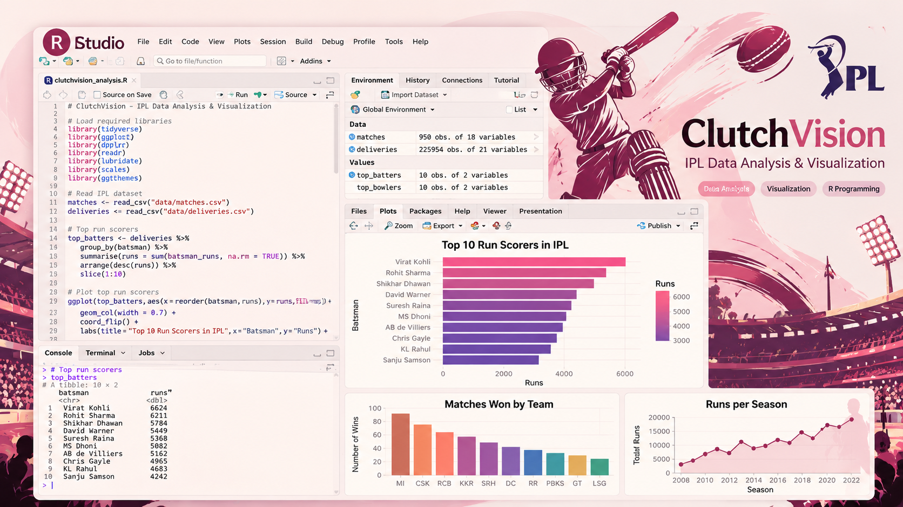

<!-- Profile README for github.com/zarinroushan -->

<!-- HERO: intro on the left, transparent portrait on the right -->
<table>
  <tr>
    <td width="58%" valign="middle">
      
H E L L O, &nbsp; I ' M

      <h1>Zarin Roushan 🎀</h1>
      
<b>✦ BUILDING IDEAS INTO USEFUL THINGS</b>

      

        I enjoy building useful digital experiences, full-stack applications, and data-driven projects.
        I’m interested in creative problem-solving, exploring new technologies, and turning ideas into
        practical, engaging products.
      

      

        
        
        
      

    </td>
    <td width="32%" align="center" valign="middle">
      
    </td>
  </tr>
</table>

---

## ✦ Featured Projects

<table>
  <tr>
    <td width="50%" valign="top">
      
      <h3><a href="https://github.com/zarinroushan/freelance-hub">UniGigs</a></h3>
      <b>Student Freelance Marketplace</b>
      
A platform concept for discovering gigs, applying to opportunities, and managing freelance work.

    </td>
    <td width="50%" valign="top">
      
      <h3><a href="https://github.com/zarinroushan/pips-midnight-observatory">Dear Pip — Midnight Observatory</a></h3>
      <b>Interactive Character-Based Experience</b>
      
Brings together dreamy storytelling, playful experiences, and magical world-building, starring Pip, a little skull baby exploring dreamy worlds, enchanting stories, cozy spaces, and playful interactive discoveries.

    </td>
  </tr>
  <tr>
    <td width="50%" valign="top">
      
      <h3><a href="https://github.com/zarinroushan/NammaSpeak">NammaSpeak</a></h3>
      <b> Learn Kannada Through Real Conversations</b>
      
An interactive Kannada-learning app for everyday conversations, practical phrases, quizzes, pronunciation practice, and AI-powered learning with offline translation support.

    </td>
    <td width="50%" valign="top">
      
      <h3><a href="https://github.com/zarinroushan/clutchvision">ClutchVision</a></h3>
      <b>IPL Data Analysis &amp; Visualization</b>
      
A project focused on exploring IPL/cricket data through analysis and visualizations using R.

    </td>
  </tr>
</table>

<table>
  <tr>
    <td align="center" bgcolor="#FBE5EA">
      <h3>
        <a href="https://github.com/zarinroushan?tab=repositories">
          ◉ See all my projects on GitHub →
        </a>
      </h3>
      
Explore more repositories, experiments, and contributions.

    </td>
  </tr>
</table>

---

## 🧰 Tools I’ve Worked With Till Now

---

# 📊 GitHub Stats:

  

   

  

   

  

  

<i>Building, learning, and turning ideas into things people can use. ♡</i>

